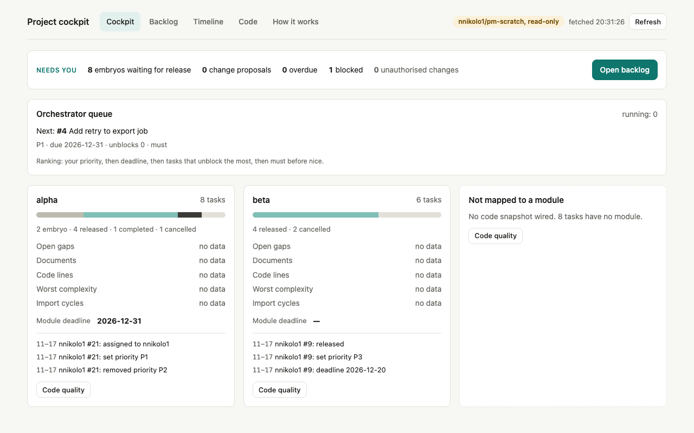

# Project cockpit

A pocket-size Swiss Army knife for agent-assisted software development, in a nutshell and opinionated: a light-weight viewer over GitHub for agent-assisted projects, with a small element of continuous integration and delivery and of an artefact store for the projects it serves ([ADR 0021](docs/adr/0021-ci-cd-and-artefact-store.md)). **Not** yet another project management system: no accounts, and the state of tasks stays in GitHub; what it generates (card data, code snapshots, reports, archives) are plain files in a known place with their age and version.

More: [task queue](docs/screens/backlog.png), [timeline](docs/screens/timeline.png).

## The opinion
- States: embryo, released, WIP, unmerged, failed, merged (the last four are labels the Dispatcher sets); cancelled is a separate marker.
- Only the Manager releases, prioritises, sets deadlines or cancels.
- Deadlines are optional: set by the Manager, or inherited from the parent or module.
- Priority is P1-P3.
- Blockers and priority are always visible.

Full text: [docs/constitution.md](docs/constitution.md).

## Quickstart
Needs Python 3.14 (the version it is developed and tested on) and an authenticated [`gh`](https://cli.github.com/).

    python3 cockpit.py --repo OWNER/REPO [--project N] [--read-only]

Open the printed `http://127.0.0.1:PORT/?t=TOKEN` URL. Optional: `--token-file PATH` (keep the token across restarts), `--modules` (JSON `{modules:[{id,name}], assign:[{path,module}]}`), `--git` (local clone), `--code DIR`.

Modules come from the Project field `Module` or `module:<name>` labels.
Sub-modules: a slash id, `alpha/one` (parent = prefix; list the parent too; optional `desc`). Label `module:alpha/one` assigns a task; the Project field stays the top level and a sub-label wins only under that top (else the field wins).
`assign` paths match by longest prefix, so a sub-module entry beats its parent; files matching only the parent stay in it. Deadlines inherit: task, parent task, sub-module, module (`MODULE_DEADLINES` keys are full ids); the Task Queue names the source.
The metrics snapshot may carry `alpha/one` entries under `modules`; the parent's entry is the producer's roll-up, a sub-module without one shows "not wired". The Code tab reads `DIR/metrics.json` plus optional `erd|dataflow|deps|js.svg` (`js.svg` is shown as the "JavaScript" view); a view appears as a sub-tab only when its file exists (the **Workflow** sub-tab always appears: it draws the task workflow of the Owner, the Interactive Session Agent, the Dispatcher and the Workers, and must be redrawn when the workflow changes), and without any a note says the code snapshot is not configured. Contract: see `code_view` in `logic.py`.

## Install
In a nutshell, from "I have a project" to "the Cockpit shows it, the daily job and the Task Queue run for it". Detail, expected output and the by-hand steps: [docs/deployment.md](docs/deployment.md), "Installation workflow".
1. Prerequisites, by hand: macOS on Apple silicon, Python (tested on 3.14; the installer uses the latest version it finds and warns when it is not 3.14), `gh auth login` as the Manager, Apple's `container` tool, the model credential in a 0600 file.
2. Get it: `git clone https://github.com/nnikolo1/project-cockpit`.
3. Add a project: `python3 tools/project_sync.py init` (planned: PC-92); until then `kit/setup.sh OWNER/REPO` and an entry in `~/.config/project-cockpit/projects.json`, by hand.
4. Viewer as a service: `python3 cockpit.py --projects FILE --token-file F` in a LaunchAgent or systemd unit, by hand.
5. Daily upkeep job (planned: PC-91); Dispatcher: `python3 -m dispatcher.launchd render --project NAME --repo OWNER/NAME --repo-dir DIR --token-file F`, then the printed `launchctl bootstrap` lines and the image build, by hand.
6. First run: `python3 tools/code_snapshot_refresh.py --project NAME`, `python3 tools/cardmeta_collect.py --project NAME --repo DIR --map MAP`, then `python3 tools/metadata_gaps.py --project NAME` lists the gaps to expect.
7. Verify: one self-test command (planned, no task yet).
8. Upgrade: `git pull --ff-only` and restart; uninstall: unload the jobs, delete the data folder.

## Card metadata
Module and sub-module cards show three blocks read from files a producer writes: **churn** (commits, lines, net and the trend against the 10 days before, for the last 10 days only: the constant `CARD_CHURN_DAYS` in `logic.py`, which the collector also uses; the 30 and 90 day windows stay in the file for other views; the band is ranked on the 10-day window, coloured by rank within the project: `▲ hot` top fifth, `▽ cold` bottom fifth, `– dormant` no change; a button switches to churn relative to size), **persistence footprint** (tables, files and folders, logging, volume, backup and retention, with "undocumented" shown as a gap) and **file ambiguity** (unsorted files with candidates, a marker above 30 percent; module-level ambiguous files on the overview). Every block says "as of" and warns when older than 48 hours; no file means "no data". The Code tab has a **Changes** sub-tab: one small bar chart per module (sub-modules indented), weekly churn of the last 52 weeks split into source, tests and documents, ranked by the last 30 days; it reads the optional `series.weekly` key of `churn.json` (a module without it shows "no weekly data yet"). Do not confuse three churn numbers: the cards show the **last 10 days** of `churn.json`, the Changes view **52 weekly bars** ranked by the 30-day window, and the Quality view's **Churn** tile counts commits touching files over the code snapshot's own window (90 days, from `metrics.json`, not from `churn.json`). Contract: [docs/contracts/card-metadata.md](docs/contracts/card-metadata.md); folder setting `meta` per project: [docs/deployment.md](docs/deployment.md).

## Module pages
Clicking a module or sub-module (chips or cards) opens its page, with the task list last. The page shows the name and path, a description, the module's part of the **Workflow** highlighted (the rest dimmed) and its own diagram, **how it relates to the rest** (the other modules whose files it imports and which import it, computed with `ast` over the Python files the module map assigns, with the number of imports and up to three example file pairs; imports inside the module are not shown, so a sub-module also shows its parent and siblings), the key files grouped by folder with counts, the documents whose `Modules:` line names it, the weekly change chart, the persistence footprint and the file ambiguity.
Content lives in `docs/modules/` next to the module map, named after the module id with `/` replaced by `-`: `<id>.txt` (paragraphs separated by blank lines, the first is the short description; no file: the `desc` of the map), `<id>.svg` (a static drawing in the Workflow's classes; sanitised on the way in: only the drawing helpers' elements and attributes, no scripts, no external references) and `<id>.hl` (one Workflow element id per line, e.g. `wf-fire`; the ids are the `G('id', ...)` calls of `wfSvg()` and `tests/test_modulepage.py` fails when a redraw drops one). No file means no diagram and no Workflow part. `GET /api/moduledoc?id=ID` serves the page content and needs `--git` for the file, document and import parts.

## Heatmaps
The Timeline and Token Usage tabs show a GitHub-style calendar heatmap (52 weeks ending today, five shades scaled to the busiest day, date and value on hover). Timeline counts one per task created, closed, labelled or assigned on its day (a choice to review) and follows the module filter; Token Usage shows the day's token total from the proxy file (which keeps 90 days) and the day's highest 5-hour quota reading when there is one.

## Metadata gaps
`python3 tools/metadata_gaps.py --project NAME [--projects-file F] [--data-dir D] [--max-age-hours 24] [--timing URL] [--tool-settings F] [--min-retention-days 3650] [--json]` reports what a project's cards, Quality view, Token Usage, Policies, module pages, footprints and documents show as missing or older than 24 hours, and a coding-tool transcript retention that is unset or too short, and exits non-zero when there is a gap (for the daily job). Read-only; every fact comes from the project's own files. Report shape: [docs/contracts/metadata-gaps.md](docs/contracts/metadata-gaps.md).
`python3 tools/code_snapshot_refresh.py --project NAME [--projects-file F] [--data-dir D] [--max-age-hours 24] [--force] [--timeout 1800]` runs the project's `code_collect` command when its code snapshot is older than 24 hours and records the result for the gap check; the daily job runs it first. Settings and record: [docs/contracts/card-metadata.md](docs/contracts/card-metadata.md), "Code snapshot".

## Module-map upkeep
`python3 tools/module_map_upkeep.py [--repo-dir DIR] [--map docs/cockpit-modules.json] [--since REF] [--write] [--file-task --repo OWNER/NAME]` compares the tree with the one of the last commit that changed the module map. Incremental changes (a file with its own entry renamed or deleted, a folder entry left without files) are reported and, with `--write`, applied to the map in the working tree (not committed); a new file an existing entry covers needs no edit. Breaking changes (a new top-level folder: a module appears; a module left without files: it disappears) edit nothing: the job reports that the map needs a complete rebuild and, with `--file-task`, files that task as an unreleased embryo labelled `author:job` (once while it is open). A new file nothing covers outside a new folder is reported as ambiguous, never guessed. JSON report on stdout; exit 2 when a rebuild is needed. Meant for the daily job.

## Submit, Cancel and the budget panel
Unless started with `--read-only`, the Task Queue table has a **Submit** column (embryos: releases the task as P2 without a deadline, the same as the Release form with its defaults) and a **Cancel** column (open tasks). Each button needs two clicks: the first turns it into "Confirm?" (it disarms after 6 seconds or on any other click), the second acts. No bulk selection. The **Budget** page shows the quota windows (used share, time to reset, age and stale marker), token numbers with the cap marked as an estimate, a table of tasks released by the boot-filling job and a table of its latest polls, all read from files a producer writes (`--quota-feed`, `--usage-report`, `--decision-log`). Contract: [docs/contracts/budget-panel.md](docs/contracts/budget-panel.md).

The **Token Usage** page (read-only) shows the Dispatcher proxy's token counts per day (the days with usage among the last 90, counted back from the latest day, newest first) and per 5-hour window (the windows with usage, newest first), a period without usage having no row ("no usage in the last 90 days" when none has), and and per task the proxy's sum next to the `tokens` of the task's good-bye note and their difference. A task launched with a Worker name in the processing log counts only that Worker's requests between its launch and its last log entry; older tasks keep the estimate marked "overlap". An **All projects** table sums the last 90 days of every project the Cockpit serves (a row per project: the four counts, the sum, the number of tasks, the last day with use; "no data" without a usage file). It also shows the exact token counts of the owner's interactive sessions (`transcript-usage.jsonl`, written by `tools/transcript_usage.py`): per period in the grading of the latest readings with the period's highest quota percentages, per source and the 20 sessions with the most tokens. Days before the transcripts come from the tool's statistics cache (`stats-cache-usage.jsonl`, written by `tools/stats_cache_usage.py`) as daily totals without a split: counted in the period's sum and the day heatmap only, marked "daily aggregate, no split", never in the per-source or per-session tables; a day with transcript data ignores them. It also shows the vendor's quota history (the 5-hour and weekly percentages: highest reading per day, and the latest readings) and uses the vendor's `resets_at` times as the 5-hour windows where readings exist (otherwise fixed blocks, labelled). It reads `proxy-usage.jsonl`, `quota-history.jsonl`, `processing/processing.jsonl` and `area/` from the project's data folder (`GET /api/usage`); a missing file shows as "no data". The proxy's usage file keeps everything.

`python3 tools/transcript_usage.py --source LABEL=DIR [--source ...] --out FILE` writes the exact token counts of Claude Code session transcripts (numbers only, one line per message) as defined in [docs/contracts/transcript-usage.md](docs/contracts/transcript-usage.md).

`python3 tools/stats_cache_usage.py --cache FILE --out FILE [--exact TRANSCRIPT_USAGE_FILE ...]` imports the daily aggregates of the tool's statistics cache as a coarse backfill (numbers only, one line per day and model, days with transcript data left out, rewritten atomically on each run) as defined in [docs/contracts/stats-cache-usage.md](docs/contracts/stats-cache-usage.md).

`python3 tools/token_reconcile.py --data-dir DIR [--cache stats-cache.json] [--tz ZONE|+HH:MM] [--json]` reconciles the token figures of a project's data folder (numbers only, writes nothing): (1) the coverage of each source (quota readings, proxy, transcripts, statistics cache, good-bye notes) and what it does not count; (2) on the days in both, the statistics cache against the transcripts (messages, sessions, tokens per model, difference and ratio, and which token definition the cache's undivided totals fit); (3) tokens per percentage point per vendor window, with the spread, and the same with cache reads weighted 1, 0.5, 0.25, 0.1 and 0, the best-fitting weight named; (4) per task the proxy's sum against the good-bye note; (5) the daily figures per UTC and per local day; (6) the known reasons for mismatch, each "observed" with its numbers or "possible". The backfill file leaves out the days with transcripts, so the comparison (2) needs `--cache`. The Token Usage page shows the result as the card **How these numbers fit** (after the period tables: the coverage table, the main matches and mismatches in sentences, the observed and the open reasons), computed by the server from the same files in the server's local zone; the optional project key `stats_cache` (path of the tool's statistics cache) gives it the overlap.

## Settings
The **Settings** page shows and changes the seven values the Dispatcher reads at each firing (on/off, interval, retries, workers, runaway, no-activity and no-start limits), kept per project in `<data dir>/<project name>/dispatcher-settings.json` (mode 0600; a missing file shows the defaults). The page refuses a runaway limit below 30 minutes, a no-activity limit below 10 and a no-start limit below 1, and shows the cap on workers (the image's worker users); the Dispatcher itself does not enforce these. A Cockpit started with `--read-only` refuses to save (403) and shows the values read-only.

The section **Module cards** holds the options of the module-card metadata: today the colour of the churn chips (by size, or by absolute churn), kept per project in `<data dir>/<project name>/cockpit-settings.json` (mode 0600; a missing file means by size). The same read-only guard applies. The legend of the card figures (hot, cold, dormant, colour key, how churn is counted) sits in the expanded metadata of each module card.

## LaunchAgents of the Dispatcher
`python3 -m dispatcher.launchd render --project NAME --repo OWNER/NAME --repo-dir DIR --token-file F [--out DIR]` writes two property lists (default folder `<data dir>/<project name>/launchd/`): the Dispatcher job `com.project-cockpit.dispatcher.NAME` (every 120 seconds) and the quota collector `com.project-cockpit.quota.NAME` (every 30 seconds; `python3 -m dispatcher.quota --snapshot F --history F` reads the status-line snapshot, default `~/.local/share/pmpoc/quota.json`, and appends a line to `<data dir>/<project name>/quota-history.jsonl` when a percentage changed; the file is append-only, mode 0600). The proxy also records every response header whose name contains `ratelimit` in that request's line of `proxy-usage.jsonl` (object `ratelimit`); this is not yet verified against the real API and is to be checked in the first real run. The proxy is no longer a job: the Dispatcher starts it (kept awake by the host helper, `caffeinate -i` on macOS) while a released task is not yet WIP or a Worker runs, and stops it otherwise. It prints their paths and the two `launchctl bootstrap gui/$(id -u) FILE` commands; it installs nothing, so copy or point `launchctl` at the files yourself, quota collector first.

## Policy findings

An agent that finds a file contradicting a standing policy files a task with `tools/file_finding.py` (`--repo`, `--title`, `--body`, `--policy`, `--file`, `--filed-by`, optional `--module`, `--dry-run`). The task carries the label `policy-finding` and the line `<!-- filed-by: AGENT-ID -->`; it counts as released at once (never for a question or a decision), the Task Queue shows a "finding" chip, and the Dispatcher never gives it to a Worker with the same id as the filer. Interactive sessions are bound by the policy text, not by this check.

## Several projects
`--projects FILE` serves several repos from one instance (replaces `--repo`, `--manager`, `--project`, `--git`, `--modules`, `--phases`, `--code`; `--port`, `--lan`, `--read-only`, `--token-file` stay global):
`{"default": "widgets", "projects": [{"name": "widgets", "repo": "acme/widgets", "project": 3, "manager": "alice", "modules": "m.json", "git": "~/src/widgets", "code": "~/snap"}, {"name": "gadgets", "repo": "acme/gadgets"}]}`.
Only `name` and `repo` are required (optional: `project`, `manager`, `modules`, `git`, `code`, `code_collect`, `phases`, `meta`, `stats_cache`). With more than one project the header shows a selector (remembered in the browser); every `/api/*` call takes `?project=NAME` (default: the `default`), `/api/projects` lists `[{name, repo}]`, and only the visible project is polled.
Rationale and limits: [ADR 0012](docs/adr/0012-several-projects-in-one-instance.md).

## Daily backup to Google Drive
`python3 tools/project_backup.py --drive DIR [--project NAME] [--projects-file F] [--data-dir D] [--cache-dir C] [--transcripts DIR ...]` writes one dated archive of a project's Cockpit data (layout: [docs/contracts/backup.md](docs/contracts/backup.md)) into `DIR/project_cockpits/NAME/`, create-only, and a status record `<data dir>/NAME/backup-status.json`. The gap checker reports a missing, failed or stale backup (kind `backup`); the Task Queue tab shows the last one. `tools/drive_retention.gs` is the Apps Script that keeps the newest 30 in Drive. Setup: [docs/deployment.md](docs/deployment.md) (Operations).

## Offline copy from a backup
`python3 cockpit.py --offline BACKUP [--port N] [--token-file F]` runs a copy of one project from its backup (an archive or a folder). It makes no GitHub call and serves every pane from the restored data, whatever its age. The page shows the banner "offline copy, data from <time>", Settings are read-only and every action is refused. `python3 tools/backup_restore.py --gaps BACKUP` lists the panes whose data is not in the backup. `python3 tools/backup_restore.py BACKUP` is the restore test: it unpacks the backup into a temporary folder, starts the Cockpit offline on it and requests every pane's data. It fails when a pane has no data or when anything tries to reach GitHub. Layout and checks: [docs/contracts/backup.md](docs/contracts/backup.md).

GitHub setup: `kit/` holds labels (`kit/setup.sh OWNER/REPO`), issue forms and the policy Action. Copy `kit/.github` to `.github` and `kit/policy.py` to `kit/policy.py` in the target repo, then `gh variable set MANAGER --body LOGIN`.

## Policies (Settings tab)
Optional `rules` key in the `--modules` JSON: `{"rules": {"groups": [{"name": "Instructions", "paths": ["CLAUDE.md", "**/CLAUDE.md"]}], "managers": ["Name or e-mail"], "bots": ["[bot]", "noreply@anthropic"]}}`. `bots` lists substrings of author name and e-mail that mark an agent-assisted change; when absent, the two values shown are the default. Globs are repo-relative; `**/` spans directories (or none), `*` and `?` stay within one path segment.
Needs `--git` (a local clone). The Policies section of the Settings tab lists the policy files and their last change, the last 90 days of changes with a diff excerpt, and open pull requests touching them.
A change is flagged when it carries a Co-Authored-By trailer or bot author, or is not by a listed Manager. Review marks stay in the browser (localStorage); nothing is stored server-side.

## How it works
- GitHub is the store; labels carry the protected state (`released`, `P1`-`P3`, `due:DATE`, `cancelled`), counted only if the Manager set them.
- One `gh` call per action. Actions are enabled unless started with `--read-only`.
- Acts as your `gh` login; stores no token.

## Limits
- One identity means no enforcement yet: the policy Action only reverts.
- Relies on GitHub sub-issues, issue dependencies, Projects and Actions variables.
- Reads the last 100 label events and 10 comments per issue.

## Deployment
Running it as a service and separating Manager, Orchestrator and Worker, with what is and is not enforced: [docs/deployment.md](docs/deployment.md).

## Decisions and notes
- Architecture decisions: [docs/adr](docs/adr/README.md).
- Memos (roles, shortcuts, roadmap): [docs/memos](docs/memos/README.md).
- The constitution: [docs/constitution.md](docs/constitution.md).

## Licence
[0BSD](LICENSE), (c) 2026 nnikolo1. Clone: `git clone https://github.com/nnikolo1/project-cockpit`.

## Assumptions

- **The agent is Claude (Claude Code).** The Workers, the Dispatcher's launch command, the Stop hook, the skill format and the proxy's credential handling assume it.
- **The host is macOS.** The Dispatcher runs under launchd, the Workers' container uses Apple's `container` tool, and the host probes (memory pressure, power source) use macOS commands.

These are assumptions, not goals. The code is kept as agnostic about the agent and the operating system as is practical: what depends on one of them stays in a small, named place (for example the container runtime adapter, the launch command, the image, the host probes), so that replacing it is a local change.

